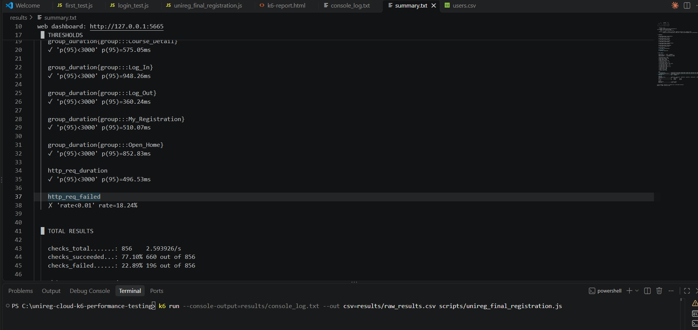
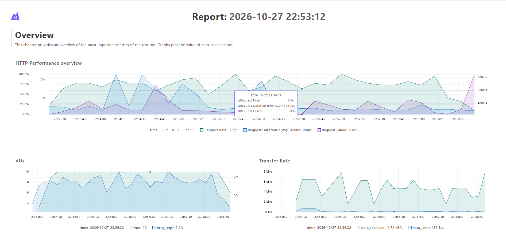
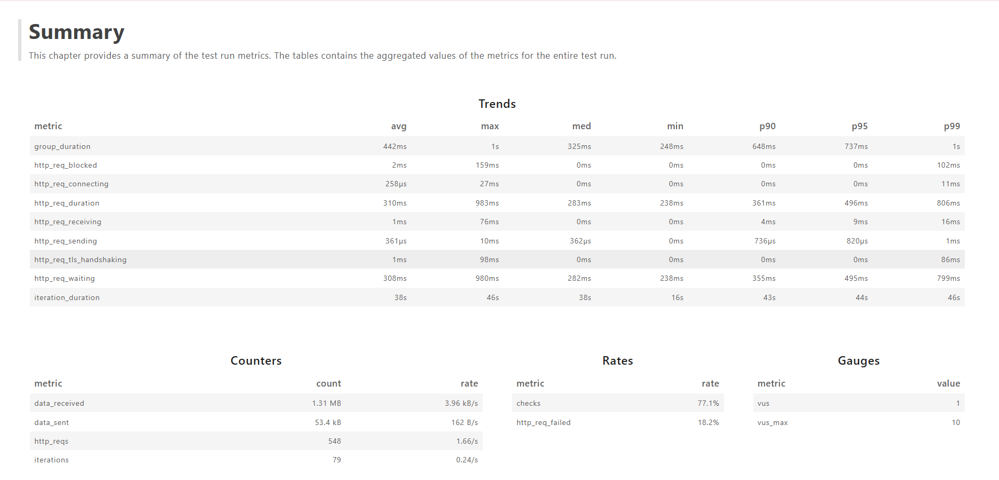
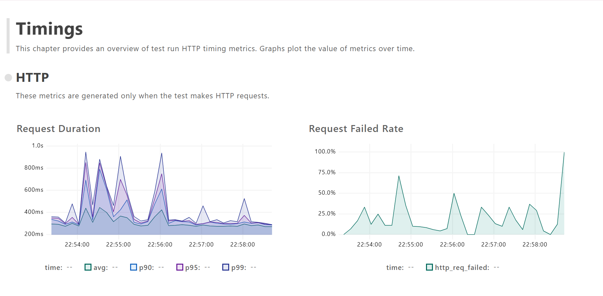
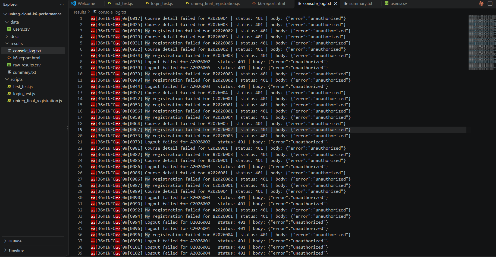

# 🎓 UniReg Cloud – k6 Performance Testing


> A k6 load test of the **final registration journey** of a multi-tenant university registration portal. It repeats the JMeter test (Task 3) with k6 so the two tools can be compared, and it confirms the same session failure under load.

Companion project (JMeter, Task 3): [unireg-cloud-jmeter-performance-testing](https://github.com/tawsif5001/unireg-cloud-jmeter-performance-testing)

## 📋 Overview

UniReg Cloud is a SaaS registration system that serves three universities (35,000 students) from one shared backend. Final registration is the riskiest moment of the semester: seats are limited, first come first served, and thousands of students log in within minutes.

This project tests that journey with k6. Each virtual student logs in with its own account, opens a random course from its own university, pauses like a human between clicks, and checks every response.

## 📏 Requirements Under Test

| ID | Requirement | Target | k6 threshold |
|----|-------------|--------|--------------|
| R2 | Page requests respond quickly | 95% within **3 s** | `http_req_duration: p(95)<3000` |
| R3 | Requests rarely fail | Error rate **< 1%** | `http_req_failed: rate<0.01` |

The thresholds give an automatic pass or fail at the end of every run.

## 🔄 User Journey

```
Open_Home        GET  /                 + GET /api/info
Log_In           POST /api/login        -> capture token
                 GET  /api/courses      -> pick a random course ID
Course_Detail    GET  /api/courses/{id}
My_Registration  GET  /api/my-courses
Log_Out          POST /api/logout
```

Each page is wrapped in a k6 `group`, so its time is measured as one step. Think time (5 to 10 s) is kept outside the groups, so it never counts as response time.

## 🧪 Script Highlights

- **Token correlation**: the token is read from the login response and sent as `Authorization: Bearer <token>`
- **Tenant-aware data**: the course ID is picked at random from the student's own university list
- **CSV data** with 10 students from 3 universities, loaded once with `SharedArray`
- **Session pinning**: virtual user *n* always uses CSV row *n*, so two users never share an account
- **Checks** on status code, token, correct course, valid JSON and logout confirmation
- **Safe error handling**: if login or the course list fails, the journey stops cleanly instead of crashing or sending requests that are sure to fail
- **Failure log**: every failed request is written with page, student, status and body

## 🔁 JMeter to k6 Mapping

| JMeter | k6 |
|--------|----|
| Thread Group (10 threads, 30 s ramp-up, 300 s) | `options.stages` |
| CSV Data Set Config + session pinning | `SharedArray` + `exec.vu.idInTest` |
| Transaction Controllers T01 to T05 | `group()` |
| JSON Extractor (`$.token`, `$[*].id`) | `res.json()` |
| Response / JSON assertions | `check()` |
| Uniform Random Timer (5 to 10 s) | `sleep(5 + Math.random() * 5)` |
| Reading pass/fail from the dashboard | `thresholds` (automatic pass/fail) |
| HTML dashboard | k6 web dashboard export |

## ⚙️ Load Profile

| Setting | Value | Reason |
|---------|-------|--------|
| Virtual users | **10** | One per test account. The portal allows one session per account, so more users would make two users share an account and log each other out. |
| Ramp-up | **30 s** | One new student every 3 s, so the servers warm up gradually instead of all users hitting cold servers at once. |
| Duration | **300 s** | The passage says a typical student stays online for about 5 minutes. Same as the JMeter test. |
| Think time | **5 to 10 s** | The passage says students pause 5 to 10 seconds between clicks. |

```
Users
 10 |      __________________________________________
    |    /
  5 |  /
    |/
  0 +-----|------------------------------------------|--> time
    0s   30s                                       300s
    ramp-up            steady state (10 users)
```

### Scale of this test

| | Users online at the same time |
|---|---:|
| University A: 50% of 20,000 log in within 10 min → 16.67 logins/s × 300 s | 5,000 |
| University B: 40% of 10,000 log in within 10 min → 6.67 logins/s × 300 s | 2,000 |
| A and B together | 7,000 |
| **Next semester target (+20% growth)** | **8,400** |
| **This test** | **10** |

This is a **scaled-down baseline at about 0.12% of the target load (1 : 840)**. The limit comes from the 10 available test accounts and the shared demo environment, not from the test machine. The test shows how the portal behaves for a small group of students; it does not prove that the portal can carry 8,400 users.

## 📁 Project Structure

```
.
├── scripts/
│   ├── unireg_final_registration.js   Final k6 test script
│   ├── first_test.js                  Learning step: first request
│   └── login_test.js                  Learning step: login and token
├── data/
│   └── users.csv                      10 demo student accounts from 3 universities
├── results/
│   ├── summary.txt                    End-of-test summary with thresholds
│   ├── raw_results.csv                Every request with its timing (like a JMeter .jtl)
│   ├── k6-report.html                 HTML dashboard with graphs
│   └── console_log.txt                Every failed request with status and body
├── docs/
│   └── images/                        Screenshots
└── README.md
```

## 🚀 How to Run

Prerequisites: k6 v1.0 or later, and internet access to `https://uni-reg-cloud.vercel.app`.

Quick check (1 user, 1 journey):

```
k6 run --vus 1 --iterations 1 scripts/unireg_final_registration.js
```

Full test with all result files (PowerShell, from the repository root):

```powershell
[Console]::OutputEncoding = [System.Text.Encoding]::UTF8
$env:K6_WEB_DASHBOARD="true"
$env:K6_WEB_DASHBOARD_EXPORT="results/k6-report.html"
k6 run -q --console-output=results/console_log.txt --out csv=results/raw_results.csv scripts/unireg_final_registration.js | Tee-Object -FilePath results/summary.txt
```

| Part | Purpose |
|------|---------|
| `K6_WEB_DASHBOARD` | Live dashboard at `http://127.0.0.1:5665` while the test runs |
| `K6_WEB_DASHBOARD_EXPORT` | Save the dashboard as an HTML report at the end |
| `--console-output` | Write the failure log to a file |
| `--out csv` | Write every request to a CSV file |
| `Tee-Object` | Show the summary on screen and save it to a file |

Open `results/k6-report.html` in a browser to see the graphs.

## 📊 Results (final run, 27 Oct 2026)

| Metric | Result |
|--------|-------:|
| HTTP requests | 548 |
| Throughput | 1.66 req/s |
| Average response time | 311 ms |
| Median | 284 ms |
| 90th percentile | 361 ms |
| **95th percentile** | **497 ms** |
| Max | 983 ms |
| **Error rate** | **18.24% (100 × 401)** |
| Iterations | 79 complete, 1 interrupted at the end of the test |





*Virtual users rose from 0 to 10 in the first 30 s and stayed at 10 until the end, as planned.*

### Page-level response times (95th percentile)

| Page | Requests | p95 | R2 (< 3 s) |
|------|:--------:|----:|:----------:|
| Log In | 2 | **948 ms** | ✅ |
| Open Home | 2 | 853 ms | ✅ |
| Course Detail | 1 | 575 ms | ✅ |
| My Registration | 1 | 510 ms | ✅ |
| Log Out | 1 | 360 ms | ✅ |

The slowest steps are the two pages that send two requests. Every page is far below the 3 s limit.



*`http_req_waiting` (308 ms average) makes up almost all of `http_req_duration` (310 ms), so the time is spent on the server, not on the network.*

### Requirement verdict

| Requirement | Result | Verdict |
|-------------|--------|:-------:|
| R2 – 95% within 3 s | p95 497 ms, slowest page 948 ms | ✅ Pass |
| R3 – error rate < 1% | 18.24% | ❌ Fail |

## 🔍 Key Finding: Sessions Are Lost Mid-Journey

Speed is **not** the problem. The failures are all `401 {"error":"unauthorized"}` on sessions that had just logged in successfully.

| Page | Time after login | Attempts | Failed | Fail rate |
|------|------------------|---------:|-------:|----------:|
| Login | – | 80 | 0 | **0%** |
| Course list | right after | 80 | 4 | **5%** |
| Course detail | ~7 s | 76 | 20 | **26%** |
| My registration | ~15 s | 76 | 36 | **47%** |
| Log out | ~22 s | 76 | 40 | **53%** |

- **Login never fails**, so the server accepts new sessions without trouble
- **The older a session gets, the more likely it is lost**; by the last step more than half of the students had been logged out
- **Once a token is lost, every later page fails** for that student
- **No 5xx errors and no timeouts**: the server did not crash or overload
- **Errors come in bursts**, not evenly, while the load stays the same
- **All three universities** were affected



*Response time and failure rate over time. Around 22:56:00 a latency spike and a failure spike happen together. This fits the idea of a new server instance starting (slow) and not knowing existing tokens (401).*



*Every failed request in the log is `401 {"error":"unauthorized"}`. The 100 lines match the 100 failed requests in the summary.*

### Possible causes

| Possible cause | Evidence that fits |
|----------------|--------------------|
| **Sessions stored in the memory of serverless instances** | `Server: Vercel`; latency and failure spikes line up at least once; an exploratory run without ramp-up had far more errors |
| **Other clients using the same shared demo accounts** | Errors come in bursts unrelated to our own load; the first error came at 17 s, before all 10 users were active |

These two causes cannot be separated from the client side. Server logs are needed to confirm.

## ⚖️ Comparison with JMeter

| Metric | k6 (final run) | JMeter (Run 2) |
|--------|---------------:|---------------:|
| Users / ramp-up / duration | 10 / 30 s / 300 s | 10 / 30 s / 300 s |
| Requests | 548 | 632 |
| Throughput | 1.66 req/s | 2.11 req/s |
| Average | 311 ms | 293 ms |
| Median | 284 ms | 281 ms |
| 90th percentile | 361 ms | 351 ms |
| 95th percentile | 497 ms | 376 ms |
| Error rate | 18.24% | 14.87% |
| Error types | 401 only | 401 and 404 |
| Login errors | 0% | 0% |

Two different tools and two different scripts show the same pattern: fast responses, no login failures, and 401 errors that grow with session age. So the problem is in the portal, not in the test.

k6 sends fewer requests because it stops a journey when the course list fails. JMeter continued with `COURSE_NOT_FOUND` and got extra 404 errors. The k6 error rate therefore counts only real failures.

### Exploratory runs

Before the final run, the script was built and checked in several shorter exploratory runs. Their result files were not kept; only the final run above is the official result. Two observations from them guided the final design:

- A run where all 10 users started **at the same moment** (no ramp-up) was much slower (p95 above 3 s) and had far more course list errors. This is why the final test uses a 30 s ramp-up.
- Every exploratory run showed the same pattern as the final run: login never failed, all errors were 401, and the error rate stayed above the 1% limit.

## 💡 Recommendations

- Store sessions in a shared store (for example Redis) or use stateless signed tokens, so scaling does not log students out
- Provide dedicated test accounts for each tester, so R3 can be measured without interference
- Log every token invalidation with a reason
- Return specific errors such as "session expired" instead of a generic `unauthorized`
- Keep a ramp-up or queue at registration opening, since a sudden rush slowed the portal sharply
- Run a spike test and a multi-tenant isolation test next, at a larger scale with more test accounts

## 🔒 Notes

- The accounts in `data/users.csv` are public demo accounts for a test deployment
- Tokens are captured at runtime and never stored in the script
- Load was kept at 10 users to stay within the limit of a shared environment

## 👨‍💻 Author

**Tawsif Ahmed**
SQA Engineer | Performance Testing | Apache JMeter | Grafana k6

[](https://github.com/tawsif5001)
[](https://www.linkedin.com/in/tawsifahmed50/)